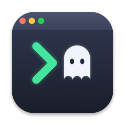
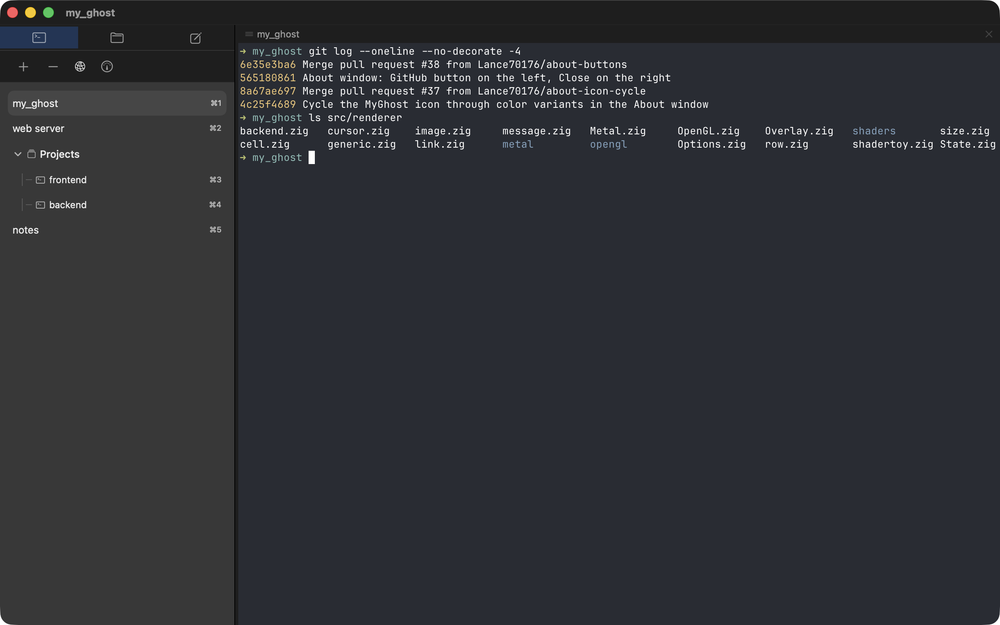
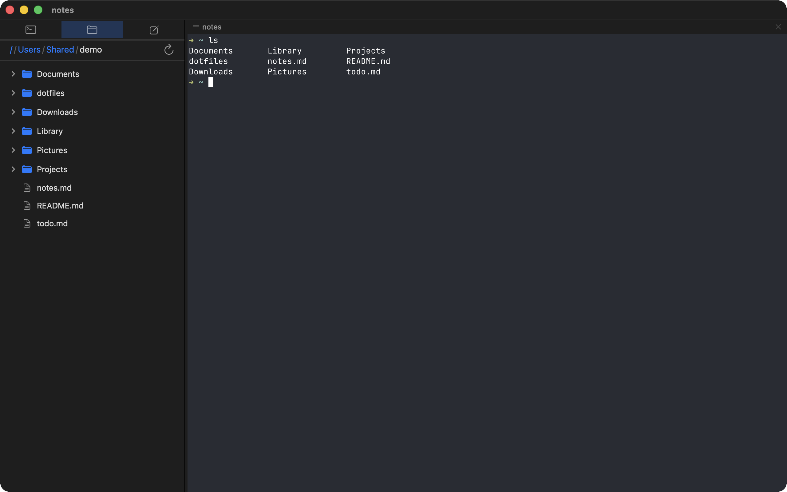
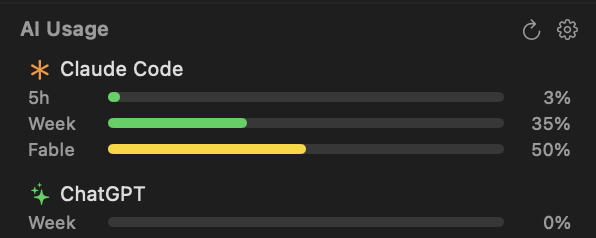

<p align="center">
  
</p>

<h1 align="center">MyGhost</h1>

<p align="center">
  A customized macOS terminal emulator based on <a href="https://github.com/ghostty-org/ghostty">Ghostty</a>,
  with sidebar tab management, persistent tmux sessions, remote SSH tabs, a built-in file browser, an AI usage dashboard,
  and optional AI project assistants that watch your Claude Code work and ask you on Telegram.
  <br />
  以 <a href="https://github.com/ghostty-org/ghostty">Ghostty</a> 為核心的 macOS 終端機，
  內建側欄分頁管理、tmux session 持久化、遠端 SSH 分頁、檔案總管與 AI 額度儀表板，
  另可開啟 AI 專案助手：替你看著 Claude Code 的工作，需要決定時在 MyGhost／Telegram 出卡問你。
</p>

<p align="center">
  <a href="https://github.com/Lance70176/my_ghost/releases/latest/download/MyGhost.dmg"><b>⬇️ Download MyGhost.dmg（下載最新版）</b></a>
  ·
  <a href="https://github.com/Lance70176/my_ghost/releases">All releases（所有版本）</a>
</p>

## Platforms · 平台入口

| Platform | How to use |
| --- | --- |
| **macOS** | Native app — [download `MyGhost.dmg`](https://github.com/Lance70176/my_ghost/releases/latest/download/MyGhost.dmg), drag to Applications.<br>原生 App：下載 DMG 拖進 Applications 即可。 |
| **Windows / Linux / any browser** | [**MyGhost Web**](web/README.md) — run the bundled web server on the Mac that owns your sessions, then open the printed URL from any browser: same tabs, terminal, file browser, and AI usage panel.<br>在持有 session 的 Mac 上啟動內附的 web 伺服器（`web/start.sh`），任何瀏覽器開啟網址就能使用同一批分頁、終端機、檔案瀏覽器與 AI 額度面板。 |

> The terminal core and session persistence are macOS-native (Ghostty + tmux),
> so there is no standalone Windows build — MyGhost Web is the supported way to
> work from Windows.
> 終端核心與 session 持久化是 macOS 原生實作（Ghostty＋tmux），因此沒有獨立的
> Windows 版；Windows 請使用 MyGhost Web。

---

## Screenshots · 截圖

**Sidebar tab management — tabs, groups, and ⌘1–9 switching**
**側欄分頁管理 — 分頁、分組與 ⌘1–9 快速切換**



**Built-in file browser — tree view, breadcrumb navigation, Quick Look**
**內建檔案總管 — 樹狀清單、路徑導覽列、快速預覽**



**AI usage dashboard — Claude Code / ChatGPT (Codex) quota at a glance**
**AI 額度儀表板 — 一眼掌握 Claude Code / ChatGPT (Codex) 用量**



---

## Features (English)

- **Sidebar tab management** — a visual tab list on the left instead of native tabs: drag to reorder, group tabs into collapsible Tab Areas (join / unjoin), rename tabs, and switch with `Cmd+1`–`Cmd+9` (group children included).
- **New-tab presets** — `Cmd+T` (or the sidebar **+**) opens a picker: Enter for a plain tab, or pick a saved preset that names the tab and types its commands one by one (e.g. `cd ~/projects/app` then `claude`). Presets carry tags (one per Mac, say) and live in `~/Library/Application Support/MyGhost/tab_presets.json`, so you can copy them to another Mac.
- **Persistent sessions** — every tab runs inside a local tmux session, so shells survive app quits, crashes, and reinstalls. Reopen the app and all tabs (including groups and their order) reattach automatically.
- **Remote SSH tabs** — open a tab that connects to a remote host over SSH into a persistent remote tmux session with automatic reconnection. Drag-select copy works in remote TUI apps (OSC 52 forwarding), and `Cmd+V` with an image on the clipboard uploads it to the remote host and pastes the file path — handy for tools like Claude Code running remotely.
- **File browser** — a sidebar file tree with breadcrumb navigation and auto-refresh: Quick Look preview (Space), rename (Enter), Move to Trash (`Cmd+Delete`), drag a file into the terminal to insert its path, and a right-click context menu (Open, Quick Look, Rename, Show in Finder).
- **Built-in text editor** — double-click a file in the browser to edit it in a Sublime-style editor pane with tabs and font zoom; new untitled files, `Cmd+F` / `Cmd+Opt+F` find and replace, and the usual line, indent and comment shortcuts.
- **AI usage dashboard** — track Claude Code, ChatGPT (Codex) and Antigravity (agy) rate-limit windows (5h / week / month) per account, with usage bars, reset countdowns, and multi-account support. Sign in via the local CLI or paste a token.
- **AI project assistants (optional, off by default)** — one Claude assistant per project, run by the bundled `ghost-agentd` service. Permission prompts from your Claude Code sessions become decision cards in MyGhost, on Telegram and on the phone page; the assistant talks with you in a Telegram group, proposes work and starts it in a new conversation only when you press **Start**, and can watch a work Telegram account and draft replies for you to send. See [the tutorial](#ai-project-assistants--ai-專案助手) below.
- **Five interface languages** — English, 繁體中文, 简体中文, 日本語, or follow the system, switched live from the globe menu at the top right.
- **Clipboard that just works in tmux** — drag-select copies even inside mouse-reporting TUI apps, and selections land straight on the macOS clipboard.
- **Everything Ghostty has** — GPU-accelerated rendering (Metal), splits, themes, fonts, and the rest of upstream Ghostty's features.

## 功能介紹（繁體中文）

- **側欄分頁管理** — 以左側視覺化清單取代原生分頁：拖曳排序、將分頁併入可收合的分組（join / unjoin）、重新命名，並可用 `Cmd+1`–`Cmd+9` 快速切換（分組內的子分頁也支援）。
- **新分頁預設** — 按 `Cmd+T`（或側欄 **+**）跳出選擇器：直接 Enter 是一般分頁；選一個預設，就會開出以它命名的分頁，並依序幫你輸入指令（例如先 `cd ~/projects/app` 再 `claude`）。預設可以掛標籤（例如每台 Mac 一個），存在 `~/Library/Application Support/MyGhost/tab_presets.json`，複製到另一台 Mac 就能共用。
- **Session 持久化** — 每個分頁都跑在本機 tmux session 裡，關閉 App、更新重裝甚至當機後，殼層程序都不會中斷；重新開啟 App 時所有分頁（含分組與排序）自動接回。
- **遠端 SSH 分頁** — 一鍵開啟連到遠端主機的分頁，殼層跑在遠端的持久化 tmux session，斷線自動重連。遠端 TUI 程式內拖曳選取可直接複製回 Mac 剪貼簿（OSC 52 轉發）；剪貼簿有圖片時按 `Cmd+V` 會自動上傳到遠端並貼上檔案路徑，遠端跑 Claude Code 等工具特別方便。
- **檔案總管** — 側欄樹狀檔案清單，支援路徑導覽列與自動刷新：空白鍵 Quick Look 預覽、Enter 重新命名、`Cmd+Delete` 丟到垃圾桶、拖曳檔案到終端機插入路徑，以及右鍵選單（開啟、預覽、重新命名、在 Finder 顯示）。
- **內建文字編輯器** — 在檔案總管雙擊檔案即可用 Sublime 風格的編輯器開啟，支援編輯分頁與字級縮放；可開未命名新檔、`Cmd+F`／`Cmd+Opt+F` 尋找與取代，整行、縮排、註解等常用快捷鍵一應俱全。
- **AI 額度儀表板** — 追蹤 Claude Code、ChatGPT (Codex) 與 Antigravity (agy) 各限額視窗（5 小時／週／月）的用量條與重置倒數，支援多帳號；可透過本機 CLI 登入或手動貼上 token。
- **AI 專案助手（選用，預設關閉）** — 每個專案一位 Claude 助手，由內附的 `ghost-agentd` 服務執行。Claude Code 對話的授權請求會變成決策卡，同時出現在 MyGhost、Telegram 與手機網頁；助手在 Telegram 群組跟你對話、提出開工建議（你按「開工」才會開新對話去做），也能監看工作用的 Telegram 帳號並草擬回覆，你按「送出」才發。設定方式見下方[教學](#ai-project-assistants--ai-專案助手)。
- **介面五種語言** — English、繁體中文、简体中文、日本語或跟隨系統，右上角地球選單即時切換。
- **tmux 下剪貼簿直覺可用** — 即使在啟用滑鼠回報的 TUI 程式裡，拖曳選取也能直接複製，選取內容即時同步到 macOS 剪貼簿。
- **保留 Ghostty 全部功能** — GPU 加速渲染（Metal）、分割視窗、佈景主題、字型設定等上游功能一應俱全。

---

## Installation · 安裝方式

1. Download [`MyGhost.dmg`](https://github.com/Lance70176/my_ghost/releases/latest/download/MyGhost.dmg).
2. Open it and drag **MyGhost.app** into **Applications**.
3. First launch: if macOS says the developer cannot be verified, right-click the app → **Open** → **Open**.

> The app is signed with a development certificate but not notarized by Apple — intended for personal / friends use.

1. 下載 [`MyGhost.dmg`](https://github.com/Lance70176/my_ghost/releases/latest/download/MyGhost.dmg)。
2. 開啟後把 **MyGhost.app** 拖到 **Applications**。
3. 首次開啟：若出現「無法驗證開發者」，請在 App 上按右鍵 →「打開」，再點一次「打開」即可。

> 本 App 以開發者憑證簽章、未經 Apple 公證（notarize），僅供個人與朋友間使用。

**Requirements · 系統需求**：macOS 13+, Apple Silicon or Intel；session persistence needs [tmux](https://github.com/tmux/tmux)（`brew install tmux`），session 持久化功能需要安裝 tmux。

---

## Tutorials · 使用教學

### Tabs and presets · 分頁與預設

1. `Cmd+T` 開新分頁：選擇器停在「無」時直接 Enter 就是一般分頁；`↑↓` 選預設、`←→` 切換標籤、`Esc` 關閉。
2. 選擇器裡的「管理預設」可以新增預設：名稱＋一行一個指令，例如
   ```
   cd ~/projects/my-app
   claude
   ```
   指令會等 shell 準備好才依序輸入，遠端主機的分頁也適用。
3. 側欄拖曳分頁可以排序；在分頁上按右鍵 →「合併到…」就會組成可收合的分組（「取消合併」拆開）。`Cmd+1`–`Cmd+9` 切換分頁。
4. 關掉 App 或重開機後再打開 MyGhost，分頁會自己接回原本的 tmux session，裡面跑的程式不會中斷。

### Remote hosts · 遠端主機

1. 點右上角的 🖥 電腦圖示 →「新增遠端主機…」，填 SSH 目標（例如 `me@server` 或 `~/.ssh/config` 裡的別名）。請先設好金鑰登入。
2. 在那台主機上開的分頁，殼層跑在遠端的 tmux 裡，斷線會自動重連。
3. 剪貼簿有圖片或檔案時按 `Cmd+V`，會先上傳到遠端分頁目前所在的資料夾，再貼上檔案路徑，遠端的 Claude Code 可以直接讀。

### Phone and browser · 手機與瀏覽器

在持有 session 的 Mac 上啟動 [MyGhost Web](web/README.md)（`web/install-launchd.sh`），手機或任何瀏覽器打開它印出的網址，就能看同一批分頁、打字、瀏覽檔案；有開 AI 專案助手的話，手機上也能跟助手對話、按決策卡。

### AI project assistants · AI 專案助手

> **English in brief:** install the daemon with `agentd/install.sh`, put your own Telegram user id in
> `~/.myghost/config.yaml`, turn on **MyGhost → AI Assistant**, then add an assistant from the ✦ sidebar
> (project folder + a bot from @BotFather + its group). Permission prompts from Claude Code sessions in
> that folder become cards; the assistant chats with you in the group. Details: [agentd/README.md](agentd/README.md).

這是給重度使用 Claude Code 的人用的進階功能：每個專案有一位常駐的 Claude 助手，替你看著專案裡所有 Claude Code 對話，需要你決定的事（要不要 `git push`、要不要發正式環境、要不要回覆某則訊息）都變成卡片，你在 MyGhost、Telegram 或手機上按一下就好。**助手自己不寫程式、不送出訊息**，要動手一律先出卡，等你按。

**需要準備**

- 已安裝並登入的 [Claude Code](https://docs.anthropic.com/en/docs/claude-code)（終端機能跑 `claude`）
- [uv](https://docs.astral.sh/uv/)（`brew install uv`），用來建立服務的 Python 環境
- 這個 repo 的原始碼（服務不在 DMG 裡）：`git clone https://github.com/Lance70176/my_ghost.git`
- 一個 Telegram 帳號（選用，但強烈建議：不在電腦前時就靠它）

**步驟**

1. **安裝服務**
   ```bash
   cd my_ghost
   agentd/install.sh
   ```
   這會把 `ghost-agentd` 裝到 `~/.myghost/agentd`、用 launchd 常駐（開機自動啟動），並在 `~/.claude/settings.json` 加上 hooks，讓每個 Claude Code 對話的授權請求先送到服務。服務只聽 `127.0.0.1`，不對外開放。
2. **設定你自己是「負責人」**：向 Telegram 的 [@userinfobot](https://t.me/userinfobot) 查自己的 user id，填進 `~/.myghost/config.yaml`：
   ```yaml
   telegram:
     commander_user_ids: [123456789]
   ```
   然後重啟服務：`launchctl kickstart -k gui/$(id -u)/com.myghost.agentd`。所有助手只聽負責人（和你之後加的成員）的話。
3. **打開 MyGhost 的功能開關**：選單列 **MyGhost → AI Assistant**（打勾）。側欄會多出 ✦ 按鈕，右下角會出現決策卡。
4. **準備 Telegram bot 和群組**（每個專案一組）：
   - 找 [@BotFather](https://t.me/BotFather) 用 `/newbot` 建一個 bot，記下 token。
   - 建一個 Telegram 群組，把 bot 拉進去並**設為管理員**（不然 bot 只看得到指令，看不到一般訊息）。
5. **新增助手**：點側欄 ✦ → 最下面「＋ 新增助手」，填：
   - 專案名稱與專案資料夾（這個資料夾底下的所有 Claude Code 對話都歸這位助手）
   - bot token → 按「檢查」，選剛剛的群組（找不到就先在群組裡講一句話再檢查，或之後在群組裡傳 `/chatid` 綁定）
   - 「隨時監測」：打勾的話助手一直在線，不勾就有事才叫醒、閒置 30 分鐘後休息
   
   按「建立」就生效，不用重啟。
6. **開始用**：
   - 在群組裡（或 ✦ 畫面中間）直接跟助手講話，例如「看一下目前有哪些對話在跑」「幫我規劃這張需求單」。
   - 專案裡的 Claude Code 要做有風險的事時，會跳出決策卡。卡片依當天編號（#1、#2…），在任何一處按了，其他地方都會同步變成「已處理」。
   - 助手提出的開工建議也是卡片；按「開工」才會在專案裡開一個新的 Claude Code 對話去做，做完會回報給助手。

**決策卡分級**

| 等級 | 處理方式 | 例子 |
| --- | --- | --- |
| L0 | 直接放行 | 讀檔、`git status`、跑測試、改專案內的檔案 |
| L1 | 放行後通知 | `git commit`、按過「此專案一律允許」的指令 |
| L2 | 出卡等你按 | `git push`、`rm`、裝套件、連資料庫 |
| L3 | 出卡＋二次確認，不能設成一律允許 | 正式環境、`--force` push、`sudo`、`DROP TABLE` |

服務沒在跑、或沒有地方能顯示卡片時，Claude Code 會照常在終端機問你，不會卡住。單一對話想完全略過服務，在環境變數設 `GHOST_AGENTD=off`。

**進階（選用）**

- **成員**：在群組裡回覆某人的訊息並傳 `/addmember`，他就能跟助手講話、按自己交辦的卡；`/members` 列出、`/removemember` 移除。成員那一輪的助手只能看本專案的檔案。
- **工作 Telegram 帳號**：讓助手監看你工作用的 TG 帳號，收到要回的訊息時草擬回覆卡，你按「送出」才用那個帳號發出。設定與登入方式見 [agentd/README.md](agentd/README.md#work-accounts--工作帳號)。
- **另一台 Mac**：在遠端主機分頁的那台也裝好服務，MyGhost 切到那台主機時，✦ 就會顯示那台的助手（經 SSH 轉發，服務一樣只聽本機）。
- **解除安裝**：`agentd/install.sh --uninstall`（設定和紀錄保留在 `~/.myghost`）。

---

## Building · 從原始碼建置

Requires [Zig](https://ziglang.org/) 0.15.2 and Xcode (with the Metal Toolchain: `xcodebuild -downloadComponent MetalToolchain`).

> **macOS 27 / recent Command Line Tools:** their SDK stubs (`.tbd`) list only `arm64e-macos`, and Zig 0.15.2
> then fails to link anything for the host (`undefined symbol: __availability_version_check`, `_abort`, …).
> Build against a copy of the SDK whose `.tbd` target lists also name `arm64-macos`, handed to Zig through an
> `xcrun` wrapper on `PATH` that answers `--sdk macosx --show-sdk-path` with that copy.
> 在 macOS 27／新版 CLT 上，SDK 的 `.tbd` 只列 `arm64e-macos`，Zig 0.15.2 會連結失敗；
> 請複製一份 SDK、在 `.tbd` 的 targets 補上 `arm64-macos`，再用放在 `PATH` 前面的 `xcrun` 包裝回傳這份 SDK 路徑。

```bash
# Debug build
zig build

# Release build
zig build -Doptimize=ReleaseFast

# Run
open zig-out/my_ghost.app

# Package a DMG (Xcode build + icon + signing)
./build/build_dmg.sh
```

## Credits

Based on [Ghostty](https://github.com/ghostty-org/ghostty) by Mitchell Hashimoto.
本專案基於 Mitchell Hashimoto 的 [Ghostty](https://github.com/ghostty-org/ghostty) 開發。
